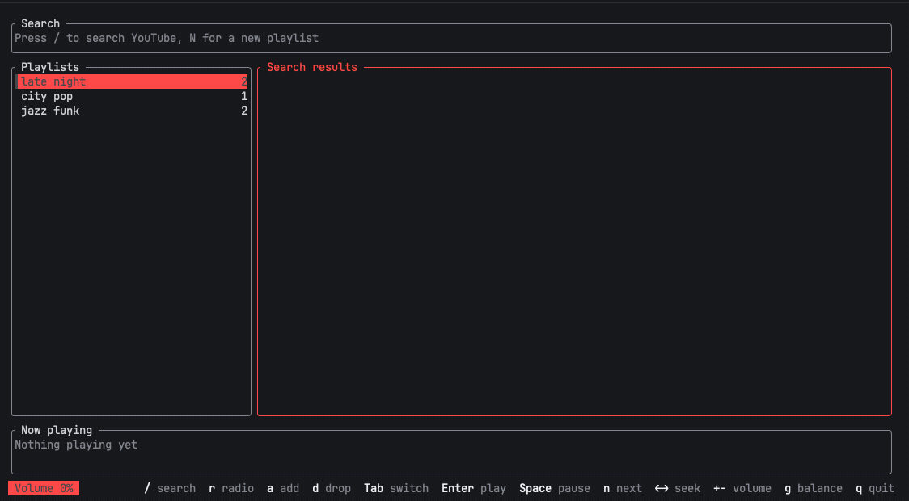

# harioto

[](https://crates.io/crates/harioto)
[](LICENSE)
[](https://github.com/Ayajiro/harioto/actions/workflows/ci.yml)

*Harioto* (針音) is the faint hiss of a stylus tracking a record groove.

A terminal radio written in Rust. Seed it with one song and it keeps playing, following YouTube's mix recommendations. Around 16 MB resident, 4 MB binary.



## How it differs

Terminal YouTube players tend to take one of two routes. YTerMusic and youtui speak the internal YouTube Music API, so a browser cookie buys them your library and your account playlists. ytui-music, rs-pug and ytmusic-cli hand playback to `mpv`, so a mature player comes with them, codecs and all.

harioto takes a third route: **no login, no second process**. `yt-dlp` fetches the audio, `rodio` decodes it in-process. That buys less — no account playlists, no artist/album browsing, just a radio that grows from a single song — and needs no setup before the first track plays.

## Playing from YouTube

The audio comes through `yt-dlp` and is decoded locally. What you point it at, and what that is appropriate for, is yours to judge. This is a tool for listening on your own machine; a record worth keeping is worth buying where the payment reaches the people who made it.

## Requirements

- `yt-dlp` — `brew install yt-dlp` on macOS, `pipx install yt-dlp` elsewhere. Distribution packages often lag months behind, and a stale yt-dlp fails silently.
- `curl`, for cover art only — already on macOS and most Linux systems
- Rust toolchain (built with 1.99.1)
- macOS, or Linux with the ALSA headers in place. `rodio` reaches the sound card through `cpal`, which links ALSA, so the build needs `libasound2-dev` on Debian and Ubuntu, or `alsa-lib-devel` on Fedora. Without them the build stops inside `alsa-sys` with a pkg-config error.

## Install

```sh
cargo install harioto
```

Or build from source:

```sh
cargo run --release
```

## Run

| Command | Effect |
| --- | --- |
| `harioto [--theme <name>] [--lang <name>]` | Start the player |
| `harioto search <query>` | Search YouTube |
| `harioto radio <id\|url>` | Build a radio from one song, seed first |
| `harioto playlist list\|show\|create\|add` | Local playlists |
| `harioto history` / `harioto seeds` | Recent plays / recent radio seeds, newest first |
| `harioto ctl <command>` | Control a running player over its socket |
| `harioto mcp` | Run as an MCP server over stdio |
| `harioto --selftest "query"` | Search, download, decode and play 5 seconds |
| `harioto --prune 200` | Trim the audio cache to the given size in MB (default 500) |

`--json` prints machine-readable output, `--limit N` caps the result count, `HARIOTO_CACHE_DIR` overrides the cache location.

## Language

The interface speaks Traditional Chinese, English and Japanese. Everything else — this file, `harioto help`, what `ctl` prints, the MCP tool descriptions, the log — stays in English, since those are read while debugging or by other programs rather than while listening.

Three places decide, in this order: `--lang zh|en|ja`, then `lang` in the theme file, then `LC_ALL`, `LC_MESSAGES` and `LANG`. English if none of them says anything. Editing the theme file switches the running player within a quarter of a second; text already on screen, such as a list title from an earlier search, keeps the words it was built with until it is rebuilt.

```json
{ "lang": "ja" }
```

## For agents

Every subcommand takes `--json`, so any agent that can run a shell command can use harioto:

```sh
harioto search "cigarettes after sex" --limit 5 --json
harioto radio sElE_BfQ67s --limit 20 --json
harioto playlist add "late night" sElE_BfQ67s --json
```

MCP clients can mount it instead, which carries the parameter schemas with the call:

```json
{ "mcpServers": { "harioto": { "command": "harioto", "args": ["mcp"] } } }
```

Tools: `harioto_search`, `harioto_radio`, `harioto_playlist_list`, `harioto_playlist_show`, `harioto_playlist_create`, `harioto_playlist_add`, `harioto_history`, `harioto_seeds`.

Calls read and write the same files the player uses and never touch a running instance. A running player notices the change within a quarter of a second and refreshes its list, and every edit it makes re-reads the file first, so edits from both sides survive. To drive a player that is already running — start a radio, skip, pause — use `harioto ctl`, described under [Remote control](#remote-control).

## Keys

| Key | Action |
| --- | --- |
| `/` | Search YouTube |
| `r` | Start a radio from the playing track, or the selected one |
| `N` | New playlist |
| `a` | Add the selected track to the selected playlist |
| `d` | Drop the selected track: from the open playlist, or from the queue a radio or search built |
| `Tab` | Switch focus between playlists and tracks |
| `j` `k` / arrows | Move the selection |
| `PageUp` `PageDown` `Home` `End` | Jump through the list |
| `Enter` | Open a playlist, or play a track |
| `Space` | Play / pause |
| `n` `b` | Next / previous |
| `←` `→` | Seek 5 seconds |
| `+` `-` | Volume |
| `g` | Loudness balance on / off |
| `i` | Cover art on / off |
| `s` | Stop |
| `q` / `Esc` | Quit |

## Remote control

A running player listens on `~/.config/harioto/ctl.sock`, so another process — a script, an agent, a second terminal — can drive the one that is already playing:

```sh
harioto ctl radio "tycho japan"   # resolve, start a radio, begin playing
harioto ctl play <id|query>       # play one track now
harioto ctl queue <id|query>      # append to the current queue
harioto ctl pause | resume | toggle | next | prev | stop
harioto ctl volume 40
harioto ctl normalize on | off | toggle
harioto ctl remove [id]           # drop a track from the queue, default the playing one
harioto ctl status --json
```

A target that looks like a video id or a YouTube URL is fetched directly; anything else is searched, and the first result wins. Tracks longer than 20 minutes are dropped before they reach the queue, and the reply says how many were skipped. Every reply carries the current state, so `status` is rarely needed on its own. A second player finds the socket taken and runs without one.

### Reading `status`

`harioto ctl status --json` answers with the live state of the player:

| Field | Meaning |
| --- | --- |
| `playing` | The current track: `id`, `url`, `title`, `channel`, `duration_ms`, `position_ms`, `paused`, `buffering`. `null` when nothing plays |
| `list` | Name of the queue the player holds, e.g. `電台：aruarian dance` |
| `index` | Zero-based position of the playing track in that queue |
| `queue_len` | How many tracks the queue holds |
| `volume` | 0–100 |
| `normalize` | Whether loudness balance is on |
| `gain_db` | The gain it applies to the current track |
| `seed` | The radio's seed — id, title, channel and style tags — or null |

`index` counts the queue the player built when the radio started, and it climbs on its own as tracks end — leave a player running for an hour and it has moved a dozen places. `harioto radio <id>` asks YouTube again and returns a fresh list whose order need not match that queue, so holding the two side by side says nothing about where the player is. `status` is the only answer to that question.

## Colours

Three presets ship with it — `ember` (the default), `mono`, which paints everything in your terminal's own foreground, and `light`. Pick one with `--theme <name>`.

`~/.config/harioto/theme.json` overrides whichever preset is in effect, one role at a time:

```json
{
  "preset": "mono",
  "border": "none",
  "cover": false,
  "lang": "ja",
  "colors": { "accent": "#7aa2f7", "muted": "244", "text": "terminal" }
}
```

Roles: `accent`, `on_accent`, `text`, `muted`, `dim`, `selection_bg`, `selection_fg`, `gauge_track`. A colour is `#rrggbb`, a 16-colour name such as `bright_blue`, a 256-colour index, or `terminal` to inherit what the terminal already uses. `border` takes `rounded`, `plain`, `thick` or `none`; `none` drops the frames and gives four more rows to the lists, which matters in a split pane. `cover` set to `false` keeps the thumbnail off and its rows with the playlists.

### Borrowing the terminal's own theme

`palette` points at a terminal theme file and fills every role from it, so the player wears the same colours as the terminal around it:

```json
{ "palette": "atom-one-dark", "colors": { "accent": "ansi:4" } }
```

`"palette": "auto"` skips the file and asks the terminal itself. At startup, before the screen is set up, the player sends OSC colour queries — foreground, background and all sixteen ANSI slots — and ends with a DA1 query as a sentinel, so a terminal that ignores colour queries still ends the wait instead of running into the 300 ms budget. A terminal that answers nothing leaves the preset in place, and the log says which happened.

Two formats are read: a Ghostty theme (`palette = 4=#61afef`, `background`, `foreground`, `selection-background`, with or without the `#`), and a JSON file holding `background`, `foreground`, an optional `selection` and sixteen `ansi` entries. A bare name is looked up in `~/.config/harioto/themes/`, `~/.config/herdr-app/themes/`, `~/.config/ghostty/themes/` and Ghostty's bundled themes; anything with a slash is taken as a path.

The palette fills the roles — text from the foreground, muted and dim from ansi 7 and 8, accent from ansi 1, the selected row from the selection colour — and anything named under `colors` still wins. There, a value may also be `ansi:0` through `ansi:15`, `fg`, `bg` or `selection`. A palette that cannot be found or parsed is skipped, with the reason in the log, and the preset stands.

The file is re-read within a quarter of a second of being saved, so a colour edit lands without restarting the player. A file that does not parse is ignored, with the reason in the log.

## Radio

The bottom line is the key hints. They are laid out from the right and keep their place; a narrow pane drops the least-used ones rather than cutting the line. Whatever just happened — a volume change, a theme reload, an error — takes the left end of that line for eight seconds and then gives it back.

The progress bar shares a row with the volume and the loudness gain, inside the now-playing block, with the clock as its label. The radio's seed and its style tags are not on screen; `harioto ctl status` reports them.

`r` takes the current track as a seed and loads the mix YouTube generates for it (`list=RD<videoID>`), up to 100 tracks in recommendation order. The seed keeps playing; the queue continues from it.

## Behaviour

- **Playback** — tracks download to the cache before playing, so seeking and replays are instant. The next track is prefetched while the current one plays.
- **Length check** — items with unknown length or longer than 20 minutes ask for a second `Enter` before playing, and are skipped during autoplay. This keeps livestreams and multi-hour compilations out of the queue.
- **Loudness balance** — every track is measured once to EBU R128 integrated loudness and true peak, then played at a gain that brings it to -14 LUFS, bounded by ±12 dB and by a -1 dBTP ceiling so a lift never clips. Measuring runs on the prefetched file, about 0.7 s of one core for a seven-minute track, and the result is kept so a track is never measured twice. `g` turns the balance off and back on; the now-playing line shows the gain in effect.
- **Pane size** — a short pane hides the frames and the idle search box so the lists keep their rows. A pane under 70 columns shows one list at a time, with `Tab` moving between the playlists and the queue, and gives the now-playing block a third row so the title, the channel and the progress bar each get their own.
- **Cover art** — the track's YouTube thumbnail is drawn under the playlists, in a panel the layout only reserves when the terminal answers a kitty graphics query at startup. The image is fetched once per track with `curl` and kept, decoded in the background, and re-sent only when the track or the panel's position changes. Shelling out keeps a TLS and HTTP/2 stack out of the binary, which a single thumbnail does not justify. A terminal that stays quiet gets the old layout, with the playlists filling the column. `i` turns the panel off and back on for the session; `cover: false` in the theme file keeps it off, and re-reading that file takes the key's word back.
- **Cache cap** — the audio cache stops at 500 MB, evicting least-recently-played files. Playing a file refreshes its timestamp; deleting a file that is currently playing is harmless.
- **yt-dlp freshness** — the version string is a release date. Past 60 days, the status bar suggests updating it — `brew upgrade yt-dlp` on macOS, `pipx upgrade yt-dlp` elsewhere — since YouTube rotates its JavaScript challenge and a stale yt-dlp fails silently.

## Files

- Audio cache — `~/Library/Caches/harioto/audio/` (`~/.cache/harioto/audio/` on Linux)
- Thumbnail cache — `~/Library/Caches/harioto/thumbs/` (`~/.cache/harioto/thumbs/` on Linux)
- Playlists — `~/.config/harioto/playlists.json`
- Control socket — `~/.config/harioto/ctl.sock`, present only while a player runs
- Theme — `~/.config/harioto/theme.json`, optional
- Loudness measurements — `~/.config/harioto/loudness.json`, one entry per track
- Play history — `~/.config/harioto/history.jsonl`, last 10,000 entries
- Radio seeds — `~/.config/harioto/seeds.jsonl`, last 2,000 entries
- Log — `~/Library/Caches/harioto/harioto.log`

History and seeds hold links and titles only — video id, URL, title, channel, timestamp. No audio, no identifiers beyond the public video id.

## Limitations

- The first track waits for a full download, a few seconds; prefetching hides it afterwards.
- Decoding prefers m4a, as `symphonia` support for Opus is incomplete.
- Media keys are not wired up: on macOS they reach an app only through `MPRemoteCommandCenter`, which needs an initialized `NSApplication` and its main run loop alongside the terminal UI.

## License

MIT
